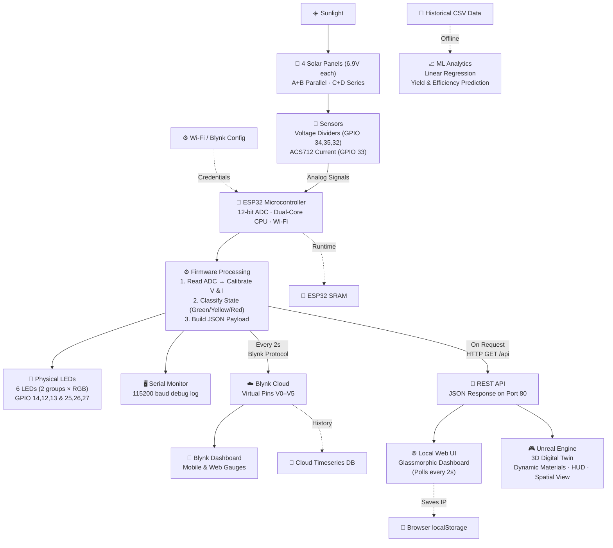
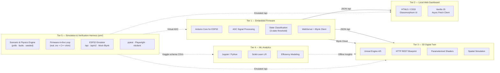
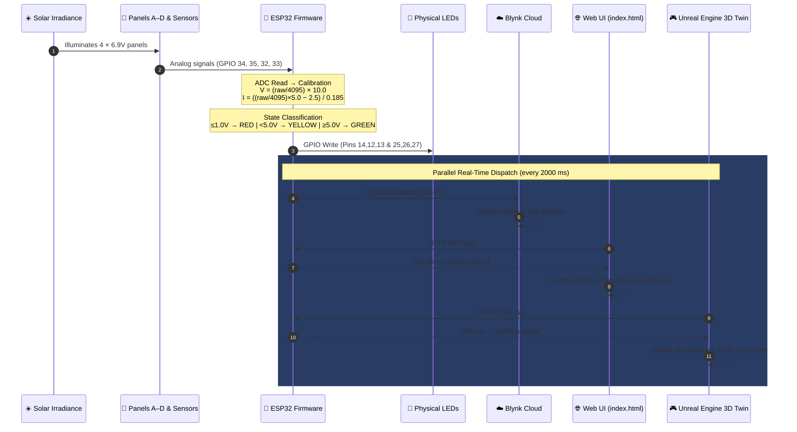
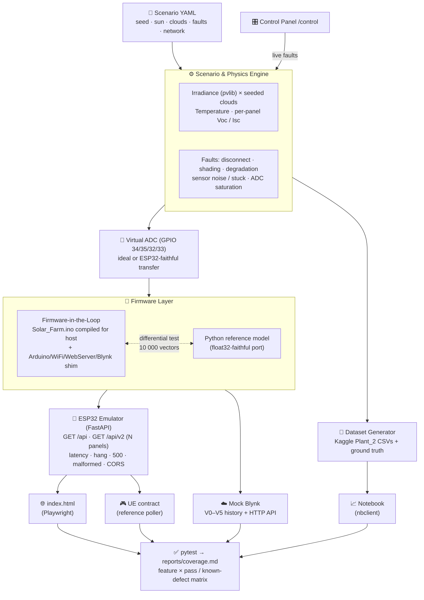

# 🌞 Digital Twin Renewable Energy Solar Farm

> **Real-Time IoT Monitoring · Blynk Cloud · Unreal Engine 3D Digital Twin · Machine Learning Analytics**

An end-to-end IoT-driven smart monitoring system that captures real-time solar panel telemetry, pushes it to a cloud dashboard and a local web interface, and mirrors the physical solar farm as a fully interactive **3D Digital Twin** inside **Unreal Engine**.

---

## 📘 Table of Contents

- [Overview](#-overview)
- [Key Features](#️-key-features)
- [Real-Time System Architecture](#-real-time-system-architecture)
  - [End-to-End Architecture Diagram](#end-to-end-architecture-diagram)
  - [Hardware Level](#-hardware-level-physical-layer)
  - [Software Level](#-software-level-firmware-middleware--applications)
  - [Storage Level](#-storage-level-data--persistence)
- [System Inputs & Outputs](#-system-inputs--outputs)
- [Real-Time Data Flow & Sequence](#-real-time-data-flow--sequence)
- [Performance Log](#-performance-log)
- [Simulation & Verification Harness](#-simulation--verification-harness)
  - [Harness Architecture](#harness-architecture)
  - [Verification Coverage & Findings](#verification-coverage--findings)
- [Demonstration Videos](#-demonstration-videos)
- [How It Works](#-how-it-works)
- [Setup Instructions](#-setup-instructions)
- [Project Structure](#-project-structure)
- [License](#-license)

---

## 📘 Overview

The **Digital Twin Renewable Energy Solar Farm** uses an **ESP32** microcontroller connected to **4 solar panels (6.9V each)**, voltage dividers, and an **ACS712 Hall-effect current sensor** to measure real-time electrical performance. The firmware processes sensor readings at a **2-second sampling interval**, classifies panel health into three states (Normal / Low / No Voltage), and simultaneously dispatches telemetry to:

1. **Blynk IoT Cloud** — remote dashboard with gauges, charts, and mobile alerts.
2. **Local REST API** (`GET /api`) — JSON endpoint served by the ESP32's on-chip web server.
3. **Local Web UI** (`index.html`) — glassmorphic browser dashboard polling the REST API.
4. **Unreal Engine 3D Digital Twin** — photorealistic virtual solar farm consuming the same REST API to drive dynamic materials, HUD overlays, and spatial inspection in real time.
5. **ML Analytics Pipeline** (Jupyter/Python) — offline linear regression models for yield forecasting and DC-to-AC efficiency estimation.

---

## ⚙️ Key Features

| Feature | Description |
| :--- | :--- |
| 🔋 **Real-Time Energy Monitoring** | Tracks individual panel voltage (A, B, C) and current (D) with 12-bit ADC resolution at 2 s intervals. |
| ☁️ **Blynk Cloud Dashboard** | Live gauges, trend graphs, and mobile push alerts via Virtual Pins V0–V5. |
| 🌐 **Local IP Web UI** | Responsive glassmorphic dashboard with async REST polling and virtual LED indicators. |
| 🚦 **Hardware LED Status** | 6 physical tri-color LEDs (2 groups × RGB) indicate panel health on the rig itself. |
| 🎮 **Unreal Engine 3D Digital Twin** | Interactive 3D virtual solar farm with dynamic material shaders, real-time HUD, and spatial inspection. |
| 📊 **ML Power Prediction** | Scikit-Learn linear regression forecasts AC output power from DC yield features (R² scoring). |
| 🔌 **REST JSON API** | Lightweight `/api` endpoint returns structured JSON for any external consumer. |

---

## 🧠 Real-Time System Architecture

### End-to-End Architecture Diagram

> The system flows **top-to-bottom** through 5 clear stages: **Input → Hardware → Processing → Output Channels → Final Outcomes**.



**How to read this diagram:**
1. **Start at the top** — Sunlight hits the solar panels.
2. **Sensors** convert panel output into analog signals fed to the ESP32.
3. **ESP32 firmware** reads, calibrates, and classifies the data.
4. **Four parallel outputs** fan out simultaneously: physical LEDs, serial log, Blynk cloud push, and REST API.
5. **Three consumers** pull from the REST API: local web UI, Unreal Engine 3D twin, and (offline) the ML pipeline.

---

### ⚡ Hardware Level (Physical Layer)

| # | Component | Specification | Pin / Interface | Role |
| :---: | :--- | :--- | :--- | :--- |
| 1 | **Solar Panel A** | 6.9 V PV (Parallel with B) | Analog node → Voltage Divider | Voltage source for monitoring group AB. |
| 2 | **Solar Panel B** | 6.9 V PV (Parallel with A) | Analog node → Voltage Divider | Voltage source for monitoring group AB. |
| 3 | **Solar Panel C** | 6.9 V PV (Series with D) | Analog node → Voltage Divider | Voltage source for monitoring group CD. |
| 4 | **Solar Panel D** | 6.9 V PV (Series with C) | Analog node → ACS712 | Current source measured by Hall-effect sensor. |
| 5 | **Voltage Sensor A** | Resistive voltage divider (0–10 V input) | `GPIO 34` — ADC1_CH6 | Scales panel voltage to 0–3.3 V for ADC. |
| 6 | **Voltage Sensor B** | Resistive voltage divider (0–10 V input) | `GPIO 35` — ADC1_CH7 | Scales panel voltage to 0–3.3 V for ADC. |
| 7 | **Voltage Sensor C** | Resistive voltage divider (0–10 V input) | `GPIO 32` — ADC1_CH4 | Scales panel voltage to 0–3.3 V for ADC. |
| 8 | **Current Sensor D** | ACS712-05B (5 A, 185 mV/A, 2.5 V offset) | `GPIO 33` — ADC1_CH5 | Measures DC current via Hall effect. |
| 9 | **ESP32** | Espressif Dual-Core Xtensa LX6, 240 MHz, 520 KB SRAM, 4 MB Flash | SoC | Edge processing, Wi-Fi, web server, Blynk client. |
| 10 | **LED Group AB** | 3 × 5 mm LEDs (Red, Yellow, Green) | `R:14` `Y:12` `G:13` | Physical status for Panels A + B combined. |
| 11 | **LED Group CD** | 3 × 5 mm LEDs (Red, Yellow, Green) | `R:25` `Y:26` `G:27` | Physical status for Panel C (and D context). |

**Panel Wiring Configuration:**

| Group | Panels | Connection | Purpose |
| :---: | :---: | :--- | :--- |
| AB | A + B | **Parallel** | Combined voltage monitoring — average of two panels. |
| CD | C + D | **Series** | Current measurement and flow control. |

---

### 💻 Software Level (Firmware, Middleware & Applications)



#### Tier 1 — Embedded Firmware (`Solar_Farm.ino`)

**Signal Calibration Formulas:**

| Measurement | Formula | Notes |
| :--- | :--- | :--- |
| **Voltage** | `V = (raw / 4095.0) × 10.0` | 12-bit ADC, 10 V full-scale via voltage divider. |
| **Current** | `I = ((raw / 4095.0) × 5.0 − 2.5) / 0.185` | ACS712 5A: 185 mV/A sensitivity, 2.5 V zero offset. Negative clamped to 0. |

**Three-State Health Classification:**

| State | Condition | LED Color | Status String |
| :---: | :--- | :---: | :--- |
| 🔴 Critical | Avg voltage ≤ 1.0 V | **Red** | `RED: No Voltage` |
| 🟡 Warning | 1.0 V < voltage < 5.0 V | **Yellow** | `YELLOW: Low Voltage` |
| 🟢 Normal | Voltage ≥ 5.0 V | **Green** | `GREEN: Normal` |

**Communication Channels:**

| Channel | Protocol | Target | Interval |
| :--- | :--- | :--- | :--- |
| Blynk Cloud | Blynk protocol over TCP/SSL | Virtual Pins V0–V5 | 2000 ms (non-blocking `BlynkTimer`) |
| REST API | HTTP/1.1 `GET /api` | Any HTTP client | On-demand (request–response) |
| Serial Debug | UART 115200 baud | Arduino Serial Monitor | 2000 ms (with `sendData()`) |

**API Response Schema:**

```json
{
  "PanelA_Voltage": 6.85,
  "PanelB_Voltage": 6.80,
  "PanelC_Voltage": 6.78,
  "PanelD_Current": 1.25,
  "Status_PanelAB": "GREEN: Normal",
  "Status_PanelC": "GREEN: Normal"
}
```

#### Tier 2 — Local Web Dashboard (`index.html`)

- **Tech Stack:** HTML5, CSS3 (glassmorphism, backdrop blur, animations), vanilla JavaScript.
- **Data Acquisition:** `fetch()` polling `http://<espIP>/api` every 2000 ms.
- **Display:** Real-time voltage/current metrics, software LED circles (Red/Yellow/Green/Off), connection status indicator, configurable ESP32 IP field persisted in `localStorage`.

#### Tier 3 — Unreal Engine 3D Digital Twin

| Component | Implementation | Purpose |
| :--- | :--- | :--- |
| **Data Ingestion** | HTTP GET via VaRest plugin or UE HTTP module (Blueprints/C++) | Fetches JSON from ESP32 `/api` endpoint. |
| **3D Environment** | Photorealistic solar array, terrain, skybox with directional sun | Immersive virtual replica of the physical farm. |
| **Dynamic Materials** | Parameterized material instances driven by telemetry state | Panels shift emissive color (Green → Yellow → Red) in real time. |
| **Telemetry HUD** | UMG widget blueprints anchored to 3D panel actors | Floating voltage/current labels on each virtual panel. |
| **Spatial Inspection** | Free-fly and orbit camera with click-to-inspect | Users can navigate and query any panel in 3D space. |

#### Tier 4 — ML Analytics (`Untitled3.ipynb`)

- **Data Sources:** `Plant_2_Generation_Data.csv` and `Plant_2_Weather_Sensor_Data.csv`, read from `$SOLAR_DATA_DIR` (default: the Google Drive folder). `python -m sim generate kaggle` produces compatible synthetic data.
- **Pipeline:** Pandas data processing → Seaborn/Matplotlib visualization → Scikit-Learn modeling.
- **Models:** Linear Regression (standardised features) forecasting `AC_POWER` from DC and weather features (`DC_POWER`, `DAILY_YIELD`, `TOTAL_YIELD`, `IRRADIATION`, `MODULE_TEMPERATURE`, `AMBIENT_TEMPERATURE`).
- **Metrics:** R² score, output power vs. efficiency curves.

---

### 🗄️ Storage Level (Data & Persistence)

| Layer | Type | Technology | Data | Retention |
| :--- | :--- | :--- | :--- | :--- |
| **Edge RAM** | Volatile | ESP32 SRAM (520 KB) | Live sensor readings, JSON buffers, TCP sockets | Cleared on reboot |
| **Edge Flash** | Non-Volatile | ESP32 SPI Flash (4 MB) | Compiled firmware, bootloader, Wi-Fi creds | Persistent across reboots |
| **Client** | Local | Browser `localStorage` | Saved ESP32 IP address | Per-browser persistent |
| **Cloud** | Time-Series | Blynk IoT Cloud DB | V0–V5 historical telemetry, device state | Cloud-tier dependent |
| **Offline** | File | CSV / Google Drive | Plant generation data, weather metrics | Long-term archival |
| **Harness** | File | `data/`, `reports/`, `build/fil/` | Generated datasets, coverage reports, cached FIL binaries | Regenerable (gitignored) |

---

## 📥 System Inputs & Outputs

```mermaid
flowchart LR
    subgraph INPUTS["📥 INPUTS"]
        direction TB
        I1["☀️ Solar Irradiance"]
        I2["⚡ Analog Voltage (GPIO 34, 35, 32)"]
        I3["🔌 Analog Current (GPIO 33)"]
        I4["🔑 Wi-Fi + Blynk Credentials"]
        I5["🌐 HTTP GET /api Requests"]
        I6["📁 Historical CSV Datasets"]
    end

    subgraph CORE["🧠 PROCESSING CORE"]
        direction TB
        C1["Signal Acquisition"]
        C2["Health Classification"]
        C3["Telemetry Dispatch"]
        C4["3D Twin Rendering"]
        C5["ML Forecasting"]
    end

    subgraph OUTPUTS["📤 OUTPUTS & OUTCOMES"]
        direction TB
        O1["🚦 Physical LED Status"]
        O2["🖥️ Serial Debug Stream"]
        O3["📡 REST JSON Payload"]
        O4["☁️ Blynk Cloud Dashboard"]
        O5["🌐 Local Web UI"]
        O6["🎮 UE 3D Digital Twin"]
        O7["📈 ML Yield Predictions"]
    end

    INPUTS --> CORE --> OUTPUTS
```



### Inputs (Detailed)

| # | Input | Source | Type | Description |
| :---: | :--- | :--- | :--- | :--- |
| 1 | Solar Irradiance | Environment | Physical | Sunlight incident on the 4 solar panels. |
| 2 | Panel A Voltage | Voltage Divider → GPIO 34 | Analog (0–3.3 V) | Scaled representation of Panel A's 0–10 V output. |
| 3 | Panel B Voltage | Voltage Divider → GPIO 35 | Analog (0–3.3 V) | Scaled representation of Panel B's 0–10 V output. |
| 4 | Panel C Voltage | Voltage Divider → GPIO 32 | Analog (0–3.3 V) | Scaled representation of Panel C's 0–10 V output. |
| 5 | Panel D Current | ACS712 → GPIO 33 | Analog (0–5 V) | Hall-effect current measurement of series string. |
| 6 | Wi-Fi Credentials | Firmware constants | Config | SSID and password for network connectivity. |
| 7 | Blynk Auth Token | Firmware constants | Config | Authentication for Blynk cloud platform. |
| 8 | ESP32 IP Address | Web UI text field | Config | Target IP for REST API polling. |
| 9 | HTTP Requests | Web UI / Unreal Engine | Network | `GET /api` calls triggering JSON response. |
| 10 | CSV Datasets | Google Drive / Local | File | Historical generation and weather data for ML training. |

### Outputs & Outcomes (Detailed)

| # | Output | Destination | Format | Description |
| :---: | :--- | :--- | :--- | :--- |
| 1 | **LED Status** | Physical rig | GPIO HIGH/LOW | 6 LEDs show real-time Red/Yellow/Green state per panel group. |
| 2 | **Serial Log** | Arduino IDE Monitor | UART text | `A: 6.85 V \| B: 6.80 V \| C: 6.78 V \| D Current: 1.25 A` |
| 3 | **JSON Payload** | HTTP clients | `application/json` | Structured telemetry with voltages, current, status strings. |
| 4 | **Blynk Dashboard** | Mobile & Web app | Blynk widgets | Live gauges, charts, trend history, and push notifications. |
| 5 | **Local Web UI** | Browser | HTML/CSS/JS | Glassmorphic metrics, virtual LEDs, connection indicator. |
| 6 | **UE 3D Digital Twin** | Unreal Engine viewport | 3D render | Virtual panels change material color, floating HUD with live telemetry. |
| 7 | **ML Predictions** | Jupyter output | Plots & scores | R² accuracy, power vs. efficiency curves, yield forecasts. |

---

## 🔄 Real-Time Data Flow & Sequence



---

## 📈 Performance Log

> Detailed system performance benchmarks are tracked in [`performance.log`](./performance.log).

**Hardware & Firmware Metrics:**

| Metric | Value |
| :--- | :--- |
| Firmware Sampling Interval | 2000 ms |
| ADC Resolution | 12-bit (4096 levels) |
| Voltage Measurement Precision | ±0.0024 V (10.0 V / 4095) |
| Current Measurement Precision | ±0.0066 A (1.22 mV / 0.185) |
| REST API Response Size | ~160–220 bytes |
| REST API Latency (LAN) | < 15 ms |
| Blynk Cloud Latency | ~50–200 ms (network dependent) |
| Web UI Polling Cycle | 2000 ms |
| Unreal Engine Polling Cycle | Configurable (1000–5000 ms typical) |
| ESP32 Firmware Flash Size | ~750 KB (compiled) |
| ESP32 Free Heap (Runtime) | ~180–220 KB |
| Concurrent HTTP Clients | 4–8 (ESP32 WebServer limit) |
| Wi-Fi Standard | 802.11 b/g/n (2.4 GHz) |

**Simulation & ML Benchmark Results (`clear_day` @ `127.0.0.1:8080`):**

| Benchmark | Measured Result |
| :--- | :--- |
| Engine Tick Jitter (10 s run, 5 ticks) | Mean `2.08 ms`, P99 / Max `3.38 ms` |
| Emulator `GET /api` (160 B, 20 reqs) | Mean `16.25 ms` (min `13.38 ms`, p95 `53.50 ms`) |
| Emulator `GET /api/v2` (714 B, 20 reqs) | Mean `14.80 ms` (min `13.54 ms`, p95 `22.93 ms`) |
| Emulator `GET /state` (1925 B, 20 reqs) | Mean `15.11 ms` (min `13.78 ms`, p95 `19.06 ms`) |
| UE Reference Poller (`sim poll`) | 3 / 3 frames OK (`0` errors) |
| Kaggle Dataset Generation (34 d × 22 inv) | `0.20 s` (71,808 generation rows, 3,264 weather rows) |
| ML Analytics (Linear Regression + Efficiency) | AC/DC Efficiency `97.448 %`, LR Score `99.9993 %`, $R^2$ `100.0 %` |

**3-Minute Continuous Runtime Log (`performance.log`, 174 ticks over 180 s):**

| Metric | Min | Mean | Max |
| :--- | :--- | :--- | :--- |
| API Tick Latency (`GET /api`) | `17.11 ms` | `35.51 ms` | `54.15 ms` |
| Server CPU Usage | `0.0 %` | `0.70 %` | `2.2 %` |
| Server Memory (RSS) | `51.20 MB` | — | `90.89 MB` |

Each tick in [`performance.log`](./performance.log) records timestamped latency, polling rate (Hz), server CPU/memory, and live panel telemetry (`VA`, `VB`, `VC`, `ID`, and `AB`/`C` health states):

```text
2026-11-26 12:16:47,396 - INFO - Tick 173 processed in 24.75 ms (Rate: 40.40 Hz), CPU: 1.2%, Memory: 90.88 MB | VA=5.68V VB=4.67V VC=5.90V ID=0.00A AB=GREEN: Normal C=GREEN: Normal
```

---

## 🧪 Simulation & Verification Harness

> Full design: [`docs/SIMULATION_HARNESS.md`](./docs/SIMULATION_HARNESS.md) · Plan & success criteria: [`docs/SIMULATOR_PLAN.md`](./docs/SIMULATOR_PLAN.md)

The harness in [`sim/`](./sim) replaces the physical rig with a configurable, seeded simulation, so **every feature above can be tested on any laptop or in CI**. No ESP32, Wi-Fi, Blynk account or Unreal Engine install is needed. It drives the **unmodified** firmware, the real `index.html` and the real notebook.

### Harness Architecture



| Capability | Where |
|---|---|
| Real-time (2 s ticks) or accelerated runs, byte-identical replay with the same seed | `sim/engine.py` |
| Real firmware on your computer (FIL), differential-tested against a Python model | `sim/fil/`, `sim/firmware_model.py` |
| Legacy 4-panel `/api` + configurable N-panel `/api/v2` | `sim/emulator.py`, `sim/contracts/` |
| Kaggle-schema datasets (34 days × 22 inverters in < 1 s) + rig logs | `sim/datasets.py` |
| Interactive fault injection | `http://127.0.0.1:8080/control` |
| Scenario catalogue (clear, cloudy, night, faults, farm, ESP32-ADC, flaky network) | `sim/scenarios/` |

**Quick start**

```bash
uv sync && uv run playwright install chromium
uv run pytest                                              # full verification suite → reports/coverage.md
uv run python -m sim serve --scenario cloudy_day --backend fil   # emulate the rig with the real sketch
# open http://127.0.0.1:8080/ (or index.html, defaults to 127.0.0.1:8080); tweak conditions at /control
uv run python -m sim generate kaggle --out data/kaggle     # datasets for the ML notebook
```

### Verification Coverage & Findings

Each README feature maps to automated tests. A defect found in the system is recorded as a strict `xfail` test, so its fix PR must turn it green. These findings came out of building the harness:

| ID | Finding | Resolution |
|---|---|---|
| F1 | Firmware sends no CORS header, so the browser blocks the local web UI's `fetch` | Firmware fix PR |
| F2 | `/api` status strings are empty before the first tick and up to 2 s stale | Firmware fix PR |
| F3 | Panel B is never classified on its own (a dead B can show only YELLOW) | Open: contract decision |
| F4 | Current formula assumes a 0–5 V ADC; ESP32 reads 0–3.3 V | Open: confirm ACS712 wiring |
| F5 | `setup()` hangs forever without Wi-Fi | Firmware fix PR |
| F6 | Wi-Fi credentials committed in the sketch | Moved to gitignored `secrets.h` |
| F7/F8 | Notebook loads the generation CSV as weather data; `r2_score` args reversed; Drive-only paths | Notebook fix PR |
| F9 | Web UI `fetch` has no timeout (a hung device never shows Disconnected) | Web UI fix PR |
| F10 | Notebook regression on unscaled ~1e9 `TOTAL_YIELD` features is ill-conditioned (R² ≈ 0) | Notebook fix PR |

---

## 🎥 Demonstration Videos

| Feature | Video | Description |
| :--- | :--- | :--- |
| 🌤️ Full Project Demo | [`Digital Twin Solar Farm.mp4`](./Digital%20Twin%20Solar%20Farm.mp4) | Complete overview — sensors, dashboard, and monitoring. |
| ☁️ Blynk Cloud Dashboard | [`BLYNK.mov`](./BLYNK.mov) | Live solar panel performance via Blynk IoT Cloud. |
| 🌐 Local IP Dashboard | [`IP Web UI.mp4`](./IP%20Web%20UI.mp4) | Local ESP-based web monitoring interface demo. |
| 🧠 Digital Twin Dashboard | [`Solar Farm Dashboard.mp4`](./Solar%20Farm%20Dashboard.mp4) | Digital twin visualization and real-time analytics. |
| 🎮 UE 3D Simulation | [🔗 Google Drive](https://drive.google.com/file/d/1ea5y91UBZI5iZVrHjFSSdWAlmYECj8rJ/view?usp=sharing) | Interactive 3D Unreal Engine Digital Twin simulation. |

---

## 🧩 How It Works

```
  ┌────────────┐     Analog      ┌──────────┐    Wi-Fi     ┌──────────────┐
  │  4 × Solar │───── Signals ──▶│  ESP32   │────────────▶│ Blynk Cloud  │
  │   Panels   │    (V & I)      │ Firmware │             │  Dashboard   │
  └────────────┘                 └────┬─┬───┘             └──────────────┘
                                      │ │
                          ┌───────────┘ └──────────────┐
                          ▼                            ▼
                   ┌──────────────┐           ┌────────────────┐
                   │  Local Web   │           │ Unreal Engine  │
                   │   UI (HTML)  │           │  3D Twin (UE5) │
                   │ GET /api     │           │  GET /api      │
                   └──────────────┘           └────────────────┘
```

1. **Data Collection:** Voltage dividers and the ACS712 sensor feed analog signals from Panels A–D into the ESP32's 12-bit ADC channels.
2. **Processing & Classification:** The firmware reads ADC values, applies calibration formulas, classifies panel health into Red/Yellow/Green, and actuates physical LEDs.
3. **Telemetry Dispatch:** Processed data is sent to Blynk Cloud (every 2 s), served as JSON on `GET /api`, and printed to the serial monitor.
4. **Digital Twin Sync:** Both the local web dashboard and the Unreal Engine 3D environment poll `GET /api` to keep their virtual representations synchronized with the physical solar farm.
5. **ML Analytics:** Historical generation data is analyzed offline in Jupyter to build predictive models for yield forecasting and efficiency estimation.

---

## 🚀 Setup Instructions

### 1. Flash Firmware

```bash
# Open Solar_Farm.ino in Arduino IDE
# Select Board: ESP32 Dev Module
# Select Port: /dev/cu.usbserial-XXXX (macOS) or COMx (Windows)
# Click Upload
```

### 2. Configure Credentials

Credentials are kept out of the sketch. Copy the template and fill in your values:

```bash
cp secrets.example.h secrets.h   # secrets.h is gitignored, never commit it
```

```cpp
#define WIFI_SSID "Your_WiFi_SSID"
#define WIFI_PASS "Your_WiFi_Password"
#define BLYNK_TEMPLATE_ID   "Your_Template_ID"
#define BLYNK_TEMPLATE_NAME "Solar Farm"
#define BLYNK_AUTH_TOKEN    "Your_Auth_Token"
```

### 3. Set Up Blynk Dashboard

- Create a new template named **Solar Farm** on [blynk.cloud](https://blynk.cloud).
- Add 6 Datastreams mapped to Virtual Pins `V0`–`V5`.
- Design your dashboard with gauge and label widgets.

### 4. Open Local Web UI

- After ESP32 connects to Wi-Fi, note the IP from the Serial Monitor.
- Open `index.html` in a browser and enter the ESP32 IP address.

### 5. Connect Unreal Engine

- Import VaRest plugin (or use built-in HTTP module).
- Create an HTTP GET Blueprint targeting `http://<ESP32_IP>/api`.
- Parse JSON and bind values to material parameters and HUD widgets.

---

## 📂 Project Structure

```
Digital-Twin-Solar-Farm/
├── Solar_Farm.ino              # ESP32 firmware (sensor processing, Blynk, REST API)
├── secrets.example.h           # Credential template (copy to gitignored secrets.h)
├── index.html                  # Local glassmorphic web dashboard
├── Untitled3.ipynb             # Jupyter ML notebook (Linear Regression, efficiency)
├── performance.log             # System performance benchmarks & metrics
├── README.md                   # This architecture documentation
├── docs/
│   ├── SIMULATION_HARNESS.md   # Harness architecture, verification strategy, findings
│   └── SIMULATOR_PLAN.md       # Goals, success criteria, phased plan
├── sim/                        # Simulation & verification harness (Python 3.12, uv)
│   ├── config.py               # Scenario schema (YAML)
│   ├── physics.py              # Irradiance, clouds, temperature, PV model, faults
│   ├── adc.py                  # Virtual ADC (ideal / ESP32-faithful)
│   ├── firmware_model.py       # Python reference model of Solar_Farm.ino
│   ├── fil/                    # Firmware-in-the-loop: C++ Arduino shim + driver
│   ├── engine.py               # Clock, tick scheduling, history
│   ├── emulator.py             # FastAPI ESP32 emulator + mock Blynk + control API
│   ├── datasets.py             # Kaggle-schema + rig-log generators
│   ├── ue_poller.py            # Unreal Engine reference poller
│   ├── contracts/              # JSON Schemas for /api v1 and /api/v2
│   ├── scenarios/              # Scenario catalogue
│   ├── static/control.html     # Interactive control panel
│   └── tests/                  # pytest + Playwright + nbclient suite
├── pyproject.toml / uv.lock    # Python project
├── .github/workflows/ci.yml    # CI: lint + full verification suite
├── Digital Twin Solar Farm.mp4 # Full project demo video
├── BLYNK.mov                   # Blynk cloud dashboard demo
├── IP Web UI.mp4               # Local web UI demo
├── Solar Farm Dashboard.mp4    # Digital twin dashboard demo
└── Ip Web UI                   # Legacy placeholder file
```

---

## 📄 License

This project is for educational and research purposes.

---

<p align="center">
  <b>Built with ❤️ by Vishnu</b><br/>
  <i>ESP32 · Blynk IoT · Unreal Engine · Scikit-Learn</i>
</p>
