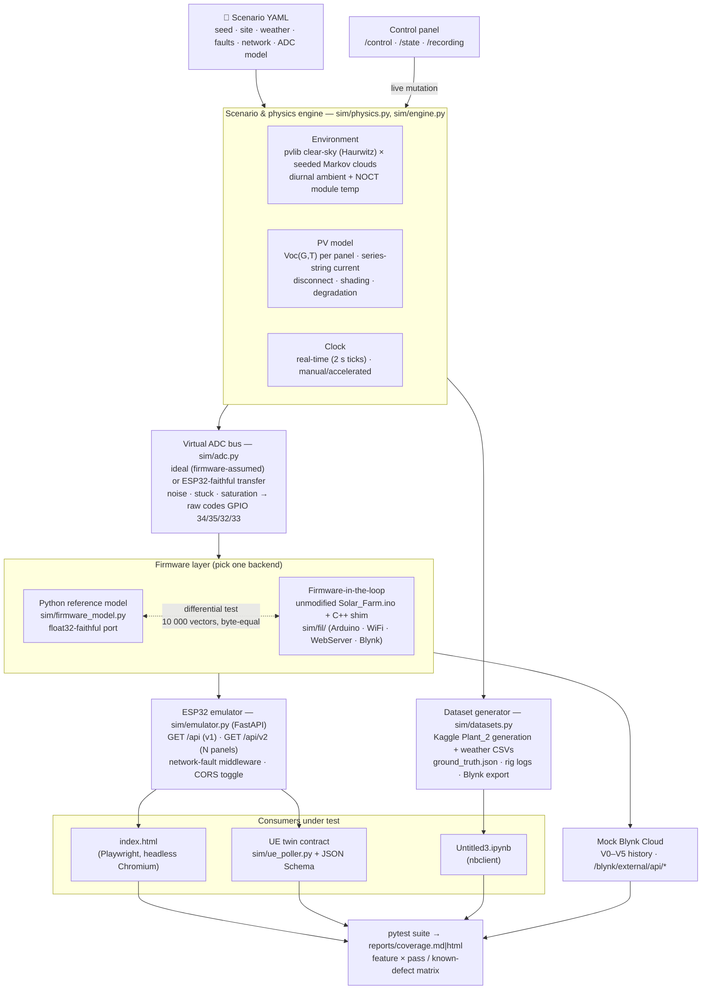
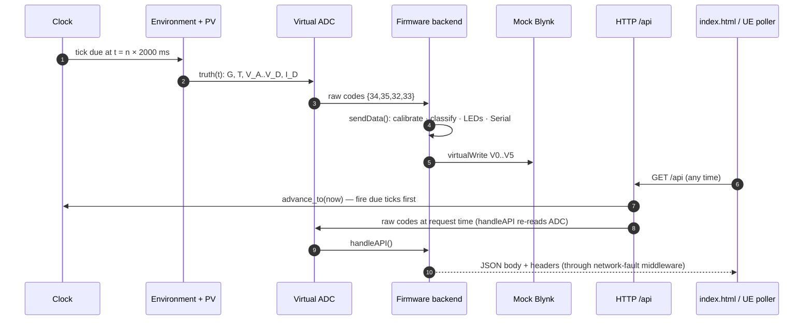

# Simulation & Verification Harness: Architecture

The harness stands in for the physical ESP32 rig, so every feature of the monitoring system can be exercised and verified **without hardware, Wi-Fi, a Blynk account or an Unreal Engine install**. It lives in [`sim/`](../sim) (Python 3.12, managed with `uv`) and leaves the system under test (SUT) unchanged: `Solar_Farm.ino`, `index.html` and `Untitled3.ipynb`.

---

## 1. Layered architecture



### Data flow per firmware tick



The engine is **lazy and deterministic**. It fires due timer ticks before serving any request, in the same order as the firmware's `loop()` (`Blynk.run()`, then `timer.run()`, then `server.handleClient()`). All randomness is seeded per `(seed, t_ms, pin)`. The same scenario and seed therefore produce byte-identical output, in real time or accelerated.

---

## 2. Components

| Module | Responsibility |
|---|---|
| `sim/config.py` | Pydantic schema for scenarios (`Scenario`, `Weather`, `Fault`, `Network`, `Farm`); YAML load/dump. |
| `sim/physics.py` | Clear-sky irradiance (pvlib), seeded cloud index, ambient and module temperature, per-panel Voc/Isc, series-string current, fault effects. |
| `sim/adc.py` | Physical → raw ADC codes. `ideal` is the exact inverse of the firmware's calibration. `esp32` models the 3.3 V full scale with a dead zone, a mid-scale bow and saturation, plus the optional ACS712 divider. |
| `sim/firmware_model.py` | Python port of `Solar_Farm.ino` that reproduces its float32 arithmetic and `String(float,2)` formatting. |
| `sim/fil/` | Host build of the **unmodified** sketch against a minimal C++ shim. Line protocol: `ADC`, `TIME`, `WIFI`, `SETUP`, `LOOP`, `GET` → `LED`/`BLYNK`/`SERIAL`/`HTTP` events. Builds are cached by content hash in `build/fil/`. |
| `sim/engine.py` | Clock (real-time or manual), lazy tick scheduling, tick history, LED/serial state, jitter measurement, `/api/v2` farm view. |
| `sim/emulator.py` | FastAPI app: `/api`, `/api/v2`, `/state`, `/control`, `/serial`, `/recording`, mock Blynk routes, network-fault middleware. Also `ServerThread` for tests. |
| `sim/blynk_mock.py` | Records `virtualWrite` calls with simulated and wall time. |
| `sim/datasets.py` | Kaggle-schema CSVs with ground truth, rig telemetry logs, Blynk history export. |
| `sim/contracts/` | JSON Schemas for `/api` v1 and v2, plus a two-decimal body check. |
| `sim/ue_poller.py` | Reference client in place of the UE blueprint: polls `/api`, validates it, and maps it to HUD labels and material colours. |
| `sim/static/control.html` | Live control panel: irradiance, per-panel shading/disconnect, ADC model/noise/saturation, network mode, CORS, LEDs, Blynk, truth. |
| `sim/scenarios/*.yaml` | Scenario catalogue: clear and cloudy days, night, lab bench, panel-B dropout, shading/degradation, sensor faults, ESP32-faithful ADC, flaky network, 16-panel farm. |

### Fault library

| Kind | Target | Effect |
|---|---|---|
| `disconnect` | A–D, P*n* | Panel produces 0 V / 0 A. |
| `shading` | A–D, P*n* | Irradiance reduced by `value` (0–1). |
| `degradation` | A–D, P*n* | Voc and Isc reduced by `value`. |
| `sensor_noise` | A–D | Gaussian σ = `value` (V, or A for D) before the ADC. |
| `sensor_stuck` | A–D | Raw code pinned to `value`. |
| `adc_saturation` | A–D | Raw code pinned to 4095. |
| network `mode` | `/api`, `/api/v2` | `latency`, `hang`, `http_500`, `malformed_json`, `missing_keys`, `down` (503). |

Each fault applies inside the window `[start_s, end_s)` and can be added or cleared live via `POST /control`.

---

## 3. Contracts

* **v1** (`sim/contracts/api_v1.schema.json`): exactly the firmware's six keys, values formatted with two decimals, status strings from a closed enum. Consumed by `index.html` and the UE twin.
* **v2** (`sim/contracts/api_v2.schema.json`): versioned, emulator-only, N panels (`farm.n_panels`), each with voltage, current, power and status. The existing consumers are deliberately left on v1.

---

## 4. Verification strategy

| Layer | How it is verified | Tests |
|---|---|---|
| Calibration and classification | Unit tests on the reference model. Boundary raws 409/410/2047/2048 and AB averages, checked on the **real firmware**. | `test_firmware_model.py`, `test_fil.py` |
| Firmware fidelity | 10 000 random and threshold-biased ADC vectors: Blynk writes, LEDs, Serial and HTTP body and headers must be identical between FIL and the Python model. | `test_fil.py` |
| Physics and faults | Day shape, night, seeded clouds, fault windows, ADC round-trip within quantisation. | `test_physics_adc.py` |
| Engine | 2 s cadence, real-time jitter < 100 ms, 12 h accelerated in seconds, byte-identical replay. | `test_engine.py` |
| `/api`, Blynk, Serial | Schema, CORS, network faults, mock Blynk API, recording. | `test_emulator.py` |
| Web UI | `index.html` from `file://` in headless Chromium, pointed at the emulator through its IP field. | `test_webui.py` |
| UE twin | Reference poller at 1, 2 and 5 s sim-time cycles; contract violations are rejected. | `test_ue_contract.py` |
| ML notebook | Executed end to end on generated data; must recover the configured inverter efficiency within ±1 %. | `test_notebook.py` |
| Datasets | Kaggle schema, yield semantics, AC ≤ DC, determinism, 34 days × 22 inverters in < 30 s. | `test_datasets.py` |
| Control panel | Playwright drives `/control`; changes must reach `/api` within one tick. | `test_control_panel.py` |
| ESP32 build | `arduino-cli compile` for `esp32:esp32:esp32` (`--run-slow`). | `test_esp32_compile.py` |

**Known defects** in the SUT are written as `xfail(strict=True)` tests whose reason starts with the finding ID (`F1`…`F9`). The fix PR for a finding removes the marker. Because the marker is strict, a fix that lands without its test flips the suite red. `reports/coverage.md` lists every README feature against passing tests and open defects.

---

## 5. Findings register

| ID | Area | Finding | Status |
|---|---|---|---|
| F1 | Firmware ↔ web UI | No `Access-Control-Allow-Origin` header, so browsers block `index.html`'s fetch. | Fix PR |
| F2 | Firmware | `/api` status strings come from the last tick: empty before the first tick, and up to 2 s stale. | Fix PR |
| F3 | Firmware | Panel B is never classified on its own; a dead B with a healthy A shows YELLOW. | Open: needs a product decision (contract change) |
| F4 | Firmware / HW | The current formula assumes a 0–5 V ADC, but the ESP32 reads 0–3.3 V. | Open: needs ACS712 wiring confirmation |
| F5 | Firmware | `setup()` busy-waits forever without Wi-Fi. | Fix PR |
| F6 | Security | Wi-Fi SSID and password committed in the sketch. | Fix PR (move to `secrets.h`) |
| F7 | Notebook | The generation CSV is loaded as `weather_data`. | Fix PR (with F8) |
| F8 | Notebook | `r2_score` arguments reversed; `DATE`/`TIME` never derived; Drive paths hard-coded. | Fix PR (with F7) |
| F9 | Web UI | `fetch()` has no timeout, so a hung device never shows Disconnected. | Fix PR |
| F10 | Notebook | Linear regression on unscaled features (`TOTAL_YIELD` ≈ 1e9) is ill-conditioned; R² collapses to ≈ 0 once the real weather features are used. | Fix PR (with F7/F8: `StandardScaler` pipeline) |

---

## 6. Running it

```bash
uv sync && uv run playwright install chromium

uv run pytest                      # full suite (~1.5 min) → reports/coverage.md
uv run pytest --run-slow           # + arduino-cli ESP32 compile check

uv run python -m sim serve --scenario cloudy_day                # Python reference backend
uv run python -m sim serve --scenario lab_bench --backend fil   # the real sketch
#   → http://127.0.0.1:8080/control   (open index.html, set ESP32 IP to 127.0.0.1:8080)

uv run python -m sim generate kaggle --out data/kaggle --days 34 --inverters 22 --seed 42
uv run python -m sim generate rig --scenario shading_and_degradation --out data/rig.csv
uv run python -m sim bench --seconds 3600   # real-time jitter
uv run python -m sim poll --url http://127.0.0.1:8080 --interval 2   # UE reference poller
uv run python -m sim replay recording.jsonl  # replay a session downloaded from /recording
```

With F1 fixed the firmware (and the reference model) send `Access-Control-Allow-Origin: *`, so `index.html` opened from `file://` can read `/api` directly. `{"network":{"cors":false}}` on `/control` simulates the old firmware.

---

## 7. Assumptions and limits

* **PV model.** The PV model is deliberately simple: a logarithmic low-light Voc and a linear Isc, with the C+D string modelled as a resistive load. It is good enough to exercise thresholds and dynamics, but it is not a bankable yield model.
* **ESP32 ADC.** The `esp32` transfer curve is an approximation of the 11 dB attenuation behaviour; calibrate it against the real rig once hardware is available.
* **Blynk.** Blynk is mocked at the `virtualWrite` boundary and through an HTTP API subset. A real-cloud adapter can use the Blynk HTTPS API once a token exists.
* **Unreal Engine.** UE is verified at the REST-contract level only; the UE project is not in the repo.
* **`down` network mode.** `down` returns HTTP 503 instead of refusing the TCP connection; the UI treats both the same way.
